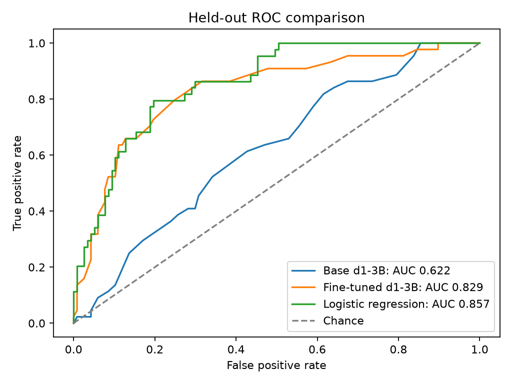
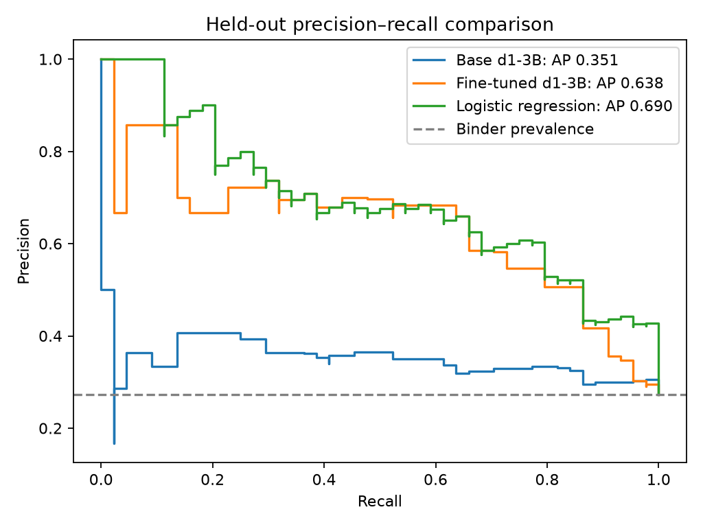

# decision-binder

## Overview

**Can a small decision model learn to predict experimentally measured protein binding from computational design and structure metrics?** This repository compares the original **LiquidAI/d1-3B** with a LoRA adapter trained on labeled binder designs. Both models are evaluated on the same held-out candidates, with the same features, rendered prompts, native decision API and metric definitions.

The primary experiment has completed preprocessing, zero-shot evaluation, Colab T4 fine-tuning and held-out adapter evaluation. See the [generated comparison table](results/comparison/primary/metrics.md), [machine-readable results](results/comparison/primary/metrics.json), and [figures](#results). Performance numbers are generated from saved predictions rather than copied into this README.

## Motivation

Computational confidence and interface scores provide useful evidence, but they are not experimental binding measurements. A supervised decision model may learn relationships among those scores, target context and observed outcomes that a general zero-shot model misses.

A roughly three-billion-parameter model makes this experiment practical on modest hardware. LoRA keeps the original weights frozen and trains small additional matrices. The question is whether this adaptation improves held-out decisions—not whether language-model confidence proves binding or replaces wet-lab validation.

## Background

[Colby T. Ford's protein-binder experiment](https://github.com/colbyford/jev-binder-classification) uses Jev-based zero-shot classification with computational folding metrics and experimental labels. Its Adaptyv notebook informs our feature aggregation and preprocessing comparator. **We reproduce aspects of preprocessing, not its reported model performance. The article did not use this repository's train/validation/test split.** Our main preprocessing also deliberately separates target forms and stoichiometries that the reference pooled.

[Liquid AI's d1-3B](https://huggingface.co/LiquidAI/d1-3B) supports structured decisions through its native System One API. We follow best practices by rendering a state and decision question, encode options as single-token aliases, and supervise the correct code followed by the end-of-turn token. At inference, we read the probability assigned to **Binder** through the supported decision API; we do not parse unconstrained generated text.

## Dataset and preprocessing

Source: [Anthropic/claude-protein-binder-design](https://huggingface.co/datasets/Anthropic/claude-protein-binder-design), revision `9e1b81696da46835e9e9cde9a3da976e0abc92ab`. Only `design_summary` and `insilico_cofold_predictions` are downloaded by preprocessing.

- **Labels:** experimentally observed Adaptyv `binder` → 1 and `non_binder` → 0. The default excludes `not_expressed`, `not_tested` and `inconclusive`; missing outcomes never become negatives.
- **Inputs:** an explicit allowlist of 85 fields: five metadata fields plus 16 structural metrics summarized by minimum, maximum, mean, median and sample standard deviation. Examples include scDockQ, ipSAE, pLDDT and interface contacts.
- **Prediction selection:** Boltz-2, primary target forms and each target's prescribed design stoichiometry—for example Cas9 RNP and TNFa trimer. Alternate forms and extra stoichiometries are excluded.
- **Missingness:** aggregate available observations per metric, then retain complete aggregate records. No imputation or scaling is applied.
- **Leakage boundary:** experimental affinity, expression, combined outcomes and unknown columns never enter the prompt. UUID is used for traceability and seeded option ordering, not included in the model's state.

Observed cohort counts are **1,440 source designs → 1,235 resolved labels → 1,076 complete records**: 294 binders and 782 non-binders. Label policy excludes 205 designs; incomplete aggregate features exclude another 159. Primary train/validation/test counts are **754 / 161 / 161**, with **206 / 44 / 44** binders. Counts are supported by the [preprocessing report](results/preprocessing_report.json), [exclusion audit](results/exclusions.csv), and [split report](results/splits/primary/report.json).

See the [data dictionary](docs/data_dictionary.md), [preprocessing methodology](docs/methodology.md), and [three fully rendered examples](results/sft/primary/examples.md).

## Experiment

The primary split is approximately 70%/15%/15%, uses seed **1337**, balances labels where feasible and keeps detected related-sequence components together. No UUID or detected component crosses splits. Target identities occur in all three primary splits.

1. Evaluate the original pinned d1-3B on validation and test.
2. Train LoRA with TRL `SFTTrainer` on the training split only; monitor validation loss. The configured experiment uses one epoch, rank 16, alpha 32 and dropout 0.05. Only answer-code and end-of-turn tokens contribute directly to the loss.
3. Evaluate the completed adapter on the exact same validation/test cohort.
4. For each model, select a threshold by validation balanced accuracy using the same fixed tie-break rule, save it before test scoring, and report ROC-AUC, PR-AUC (average precision), precision, recall, F1, balanced accuracy, accuracy and confusion matrices. Include the training-derived majority-class baseline.

The base model revision is `051bcc464b01b9f92942b364d9586b0ef5912432`. [Configuration](configs/experiment.yaml) and `uv.lock` define the experiment. A separate entire-target holdout split is supported but has **not** been evaluated; its results must never be mixed with the primary experiment.

## Quickstart

### Prerequisites

The commands below use **Bash on Linux/macOS**, Python **3.12**, and [uv](https://docs.astral.sh/uv/getting-started/installation/). The tested uv version is 0.12.1. Internet access is needed for dependency installation and the initial dataset/model downloads.

| Stage | Hardware |
|---|---|
| 01: features and splits | CPU |
| 02: prompts/completions | CPU; tokenizer only, no model weights |
| 03 and 05: inference | NVIDIA CUDA or Apple MPS recommended; CPU supported but slower |
| 04: smoke/full training | NVIDIA CUDA GPU required; T4 was used for the completed experiment |
| 06: tables and plots | CPU; no model loading |

Training checks for at least 14 GiB total and 10 GiB free GPU memory. Precision is selected automatically: fp16 on T4, native bf16 where supported. No quantization is used. Keep enough disk space for the base weights (roughly 6 GB), package environment, data and checkpoints. Local Apple Silicon training is not enabled.

### 1. Clone and install

```bash
git clone https://github.com/ahmurill0217/decision-binder.git
cd decision-binder
uv sync --frozen --python 3.12 --extra dev --extra evaluation --extra training
```

All subsequent commands run from this directory and use `.venv/bin/python`. No environment activation is required. `uv.lock` pins transitive dependencies; do not drop `--frozen` when reproducing the environment.

### 2. Create a separate configuration for your run

The checkout contains measured results from the original experiment. This creates a local configuration with a new results directory, preserving those checked-in results. Use a fresh clone for a clean reproduction; generated input data is ignored and can be regenerated.

```bash
.venv/bin/python - <<'PY'
from pathlib import Path
import yaml

path = Path("configs/quickstart.local.yaml")
if path.exists():
    raise SystemExit("Run config already exists. Reuse it or choose a new name; do not overwrite an ongoing run.")
config = yaml.safe_load(Path("configs/experiment.yaml").read_text())
config["paths"]["results"] = "results/reproduction"
config["training"]["output_dir"] = "artifacts/lora/reproduction"
path.write_text(yaml.safe_dump(config, sort_keys=False))
PY
```

The full end-to-end path below assumes an NVIDIA GPU machine or Colab terminal. For Apple Silicon, use `--device mps` in steps 03 and 05, and perform step 04 in Colab as described below. Use the same inference device/precision for base and adapted models when possible.

### 3. Run the numbered pipeline

**01 — Prepare features and create splits.** This step now includes primary split creation; no hidden intermediate command is needed.

```bash
.venv/bin/python scripts/01_prepare_data.py --config configs/quickstart.local.yaml
```

Outputs: `data/processed/binders.parquet`, `data/processed/splits/primary/{train,validation,test}.parquet`, plus preprocessing/exclusion/split audits in `results/reproduction/`.

**02 — Build supervised examples.** Download only tokenizer/prompt assets on the first run.

```bash
.venv/bin/python scripts/02_build_sft_dataset.py \
  --config configs/quickstart.local.yaml --download-tokenizer
```

Outputs: `data/sft/primary/dataset/` (Hugging Face DatasetDict), per-split Parquets with UUID/prompt/completion, and inspectable examples under `results/reproduction/sft/primary/`.

**03 — Evaluate the base model.** This downloads the pinned model weights on the first run.

```bash
.venv/bin/python scripts/03_evaluate_base.py \
  --config configs/quickstart.local.yaml --download-model --device cuda
```

Outputs: `results/reproduction/zero_shot/primary/` with prediction CSV/Parquet, resumable JSONL, threshold, metrics and run manifest.

**04 — Smoke test, then explicitly launch full training.** Run the two-step smoke test first:

```bash
.venv/bin/python scripts/04_train_lora.py \
  --config configs/quickstart.local.yaml --mode smoke \
  --output-dir artifacts/lora/reproduction_smoke
```

Confirm `metadata.json` reports `status: passed` and `adapter_reload_verified: true`. Only then run the following command if you intend to launch the full experiment:

```bash
.venv/bin/python scripts/04_train_lora.py \
  --config configs/quickstart.local.yaml --mode full --approve-full-run
```

Outputs: `artifacts/lora/reproduction/adapter/`, checkpoints, progress logs and `metadata.json`. Full training starts from the base model with a new adapter; it does not continue the smoke adapter. Keep the adapter's parent metadata file for evaluation provenance checks.

**05 — Evaluate the fine-tuned model.** This validates adapter identity and baseline cohort parity, then scores validation and test.

```bash
.venv/bin/python scripts/05_evaluate_finetuned.py \
  --config configs/quickstart.local.yaml \
  --adapter artifacts/lora/reproduction/adapter --device cuda
```

Outputs: `results/reproduction/fine_tuned/primary/`, including probabilities, predicted classes, labels, targets, UUIDs and adapter hashes. No optimizer is initialized and no retraining occurs.

**06 — Generate the comparison and figures.** Uses saved predictions and processed split records; no GPU is required.

```bash
.venv/bin/python scripts/06_compare_results.py \
  --config configs/quickstart.local.yaml \
  --training-metadata artifacts/lora/reproduction/metadata.json
```

Outputs: `results/reproduction/comparison/primary/metrics.{md,csv,json}` and five PNG/SVG figures under `results/reproduction/figures/primary/`: ROC, precision–recall, confusion matrices, class distribution, and training/validation loss. Omit `--training-metadata` if no loss history is available; the other figures still render.

### Colab and Apple Silicon

[notebooks/finetune_colab.ipynb](notebooks/finetune_colab.ipynb) is a thin wrapper around the Python training script. Select a GPU runtime, set `REPO_URL` and preferably an immutable `REPO_REF`, run the smoke test, then explicitly enable `RUN_FULL_TRAINING` if approved. Drive storage is optional but preserves outputs after the runtime ends. The wrapper uses the default experiment configuration; it is an alternative to the isolated quickstart configuration above.

For a single-environment reproduction, run all six commands in the Colab runtime/terminal. For a local→Colab→local workflow, transfer the **same** configuration, processed splits, SFT Parquets and manifests rather than regenerating them independently. Transfer the full run folder back with its `adapter/` and `metadata.json`, then pass that adapter path to step 05 with `--device mps`. See [training](docs/training.md) and [evaluation](docs/fine_tuned_evaluation.md) for details. The original experiment's Colab/local SFT hash mismatch remains a documented limitation, not an expected equivalence guarantee.

### Reruns and tests

Download flags can be omitted once the pinned assets are cached. Training refuses nonempty output directories. Evaluation resumes JSONL only when its run manifest matches exactly; code/config changes require a new run location. To repeat an experiment, create another local config with distinct `paths.results` and `training.output_dir`; preserve the old run's config and artifacts first. Never silently overwrite published results to bypass a provenance check.

```bash
# CPU unit tests: no dataset, tokenizer, model download, or GPU required
HF_HUB_OFFLINE=1 HF_DATASETS_OFFLINE=1 .venv/bin/python -m pytest -m 'not integration' -q

# Optional integration tests after preparing the pinned local assets
HF_HUB_OFFLINE=1 HF_DATASETS_OFFLINE=1 .venv/bin/python -m pytest -m integration -q
```

Unit tests cover deterministic aggregation, uniqueness, label mappings, split overlap, outcome leakage, prompt/completion contracts, and probability-to-choice mapping. Synthetic tokenizer tests do not replace native-tokenizer compatibility checks. See [reproducibility](docs/reproducibility.md).

## Repository structure

| Path | Purpose |
|---|---|
| `scripts/01_prepare_data.py` | Feature preparation plus reproducible split creation |
| `scripts/02_build_sft_dataset.py` | Native prompt/completion conversion |
| `scripts/03_evaluate_base.py` | Original-model decision probabilities and metrics |
| `scripts/04_train_lora.py` | CPU preflight, CUDA smoke, or explicitly approved full SFT |
| `scripts/05_evaluate_finetuned.py` | Adapter inference on the baseline cohort |
| `scripts/06_compare_results.py` | Generated comparison tables and figures |
| `src/decision_binder/` | Reusable preprocessing, prompts, training and evaluation modules |
| `configs/experiment.yaml`, `uv.lock` | Experiment settings and dependency resolution |
| `notebooks/finetune_colab.ipynb` | Optional execution wrapper; no duplicated training logic |
| `tests/`, `.github/workflows/tests.yml` | Synthetic CPU tests and separate asset integration tests |
| `docs/` | Methodology, detailed reproduction, provenance and licensing |
| `results/` | Small numerical/audit outputs, prediction records and figures |
| `data/`, `artifacts/`, `full/` | Generated inputs and trained/downloaded weights; ignored by Git |

`02_create_splits.py` remains available for separately regenerating splits. `05_evaluate_lora.py` is retained as a compatibility entry point that combines inference and plotting; new workflows should use steps 05 and 06 above.

## Results

The links below show the **completed original primary experiment**, not a new run's outputs. They are generated from saved predictions. New quickstart runs write to `results/reproduction/`.

- **[Generated comparison table](results/comparison/primary/metrics.md)** · [CSV](results/comparison/primary/metrics.csv) · [JSON](results/comparison/primary/metrics.json)
- [Base prediction records](results/zero_shot/primary/test_predictions.csv) · [Adapter prediction records](results/fine_tuned/primary/test_predictions.csv)
- [Completed training metadata](results/training/primary_full/metadata.json) · [Evaluation validation record](results/comparison/primary/validation.json)





[Confusion matrices](results/figures/primary/confusion_matrices.png) · [Class distribution](results/figures/primary/class_distribution.png) · [Training/validation loss](results/figures/primary/training_loss.png). All figures also have SVG versions in the same directory.

The LoRA weights are not distributed in Git. A fresh clone can inspect the saved results immediately; rerunning adapter inference requires either the original adapter with its metadata or a newly completed training run. Published literature scores are not substituted for missing experimental measurements.

## Limitations

- **Small retained dataset and class imbalance:** complete-case filtering and exclusion of failed expression change the population being studied. Report all exclusions; accuracy alone can reward majority-class predictions.
- **Assay differences:** labels describe a particular experimental endpoint; computational target forms and campaign context may not match all assay conditions. Binding is not synonymous with biological activity or therapeutic usefulness.
- **Possible leakage and confounding:** grouping uses equal-length sequence identity and can miss homologs, scaffold families and lineage. Target/generator metadata may capture campaign effects. Public-data exposure during pretraining is unknown.
- **Generalization:** primary train/test share targets. Random/grouped-split results do not establish unseen-target generalization; the separate target-holdout experiment has not been evaluated.
- **Reproducibility:** fixed seeds do not guarantee bit-identical accelerator arithmetic. The supplied Colab training SFT hashes differ from local SFT hashes; UUIDs/configurations match, but exact training prompt equality is unverified. Both compared models used the unchanged original local evaluation cohort.
- **Selection and uncertainty:** results are single-split point estimates. Thresholds use validation only. The test set has now been evaluated and must not be repeatedly used for model selection while still being described as untouched.

## References and attribution

- Anthropic: [Claude protein binder design data release](https://huggingface.co/datasets/Anthropic/claude-protein-binder-design), **CC BY 4.0**. Credit its supplied contributors, link the license, and describe our filtering/aggregation changes when sharing derived data.
- Colby T. Ford: [Zero-Shot Classification of Protein Binders with Jev](https://blog.colbyford.com/zero-shot-classification-of-protein-binders-with-jev-634b0300e58d) and [reference repository](https://github.com/colbyford/jev-binder-classification).
- Liquid AI: [d1-3B](https://huggingface.co/LiquidAI/d1-3B), its native prompt utilities, and [BANKING77 TRL tutorial](https://github.com/Liquid4All/cookbook/blob/main/finetuning/notebooks/sft_for_decision_models_with_trl.ipynb).
- Hugging Face: [TRL](https://huggingface.co/docs/trl/) and [PEFT](https://huggingface.co/docs/peft/).

The model uses **LFM Open License v1.0**, with redistribution conditions and commercial-use limitations; do not describe it as unrestricted. The repository's original-code license has not been selected, and reference-notebook redistribution permissions remain unverified. See [licensing review](docs/licensing.md) and [reference inspection](docs/references.md) before redistribution.

## Conventional tabular baseline

A fixed **logistic regression** baseline now uses the same features and splits, with numeric scaling and one-hot encoding fit only on training data. It performs no hyperparameter search and selects its threshold on validation using the same rule as d1. The baseline was added after the d1 test results were known; interpret it as an exploratory comparison.

After the six-step pipeline, run:

```bash
.venv/bin/python scripts/07_evaluate_tabular.py --config configs/quickstart.local.yaml
.venv/bin/python scripts/06_compare_results.py \
  --config configs/quickstart.local.yaml \
  --training-metadata artifacts/lora/reproduction/metadata.json
```

For an older local config, first copy the new `tabular` section from `configs/experiment.yaml`. This CPU-only extension saves prediction records and metrics under `logistic_regression/primary/` in the configured results directory. Step 06 automatically adds its completed results to the comparison table and ROC/PR/confusion plots. See [protocol and interpretation](docs/tabular_baseline.md).

The generated results do **not** currently establish an advantage of d1 fine-tuning over this conventional tabular baseline, even though fine-tuning improves d1 over its own zero-shot baseline.
